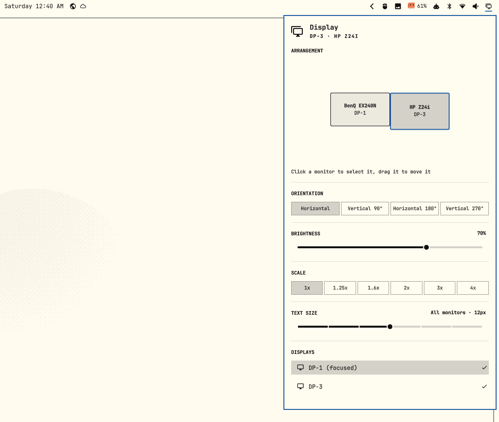

# Display panel for Omarchy

An Omarchy shell bar panel, based on the stock `omarchy.monitor`, for setting up
each monitor:

- Drag-and-drop monitor arrangement
- Orientation (horizontal, upside down, or vertical either way round), which
  the rest of the session follows (see below)
- Refresh rate, from the modes the monitor offers, with a 15-second automatic
  revert unless confirmed
- Brightness per monitor over DDC/CI
- Scale per monitor
- Text size for the whole desktop

Settings persist as one-line rules in `~/.config/hypr/monitors.lua`.

## Orientation follows the system

Turning a monitor also adapts what's on it:

- **Windows.** On a vertical monitor new windows stack top to bottom. Dwindle
  does this on its own, from the shape of the space; for the master and
  scrolling layouts the panel adds a workspace rule for that monitor
  (`orientation = top`, `direction = down`). Windows already open keep their
  split.
- **Wallpaper.** Omarchy crops one landscape wallpaper onto every screen. For a
  vertical monitor, put portrait images in
  `~/.config/omarchy/backgrounds/<theme>/vertical/`: the panel's service shows
  the one named like the current background (`1-orb.jpg` for `1-orb.webp`), or
  else the first one. Clicks still reach the desktop. Video wallpapers are left
  alone.
- **Tablet and touchscreen.** When `input.tablet.output` or
  `input.touchdevice.output` names a monitor, they get that monitor's
  transform. Bind one in `~/.config/hypr/input.lua`, for example
  `hl.config({ input = { tablet = { output = "DP-1" } } })`.

The workspace rules and input transforms live in a block in `monitors.lua`
between `-- corico.monitor: orientation` and `-- end corico.monitor`. The panel
rewrites it on every change and removes it when nothing needs adapting, so
don't edit it by hand.

The boot screen and the text console aren't turned. Plymouth only follows a
panel orientation the kernel reports, which external monitors don't have, and
the console can only be turned for every monitor at once.

## Screenshots



## Requirements

- Omarchy 4.5 or later, on Hyprland with its Lua config
- Python 3, used by `displayctl.py`
- For brightness on external monitors, DDC/CI turned on in the monitor's menu.
  Omarchy's `omarchy-brightness-display` does the work, so there's nothing extra
  to install.

## Install

```bash
omarchy plugin add https://github.com/coricogit/corico.monitor --enable
omarchy plugin disable omarchy.monitor
omarchy restart shell
```

This panel replaces the stock `omarchy.monitor` panel, so keep the stock one
disabled while this one is on. The panel opens from its bar icon or with
`SUPER+CTRL+D`.

The panel only changes `~/.config/hypr/monitors.lua` when you change a setting
in it. Refresh rate changes revert after 15 seconds unless you confirm them.

## Remove

```bash
omarchy plugin remove corico.monitor
omarchy plugin enable omarchy.monitor
omarchy restart shell
```

Your monitor rules stay in `~/.config/hypr/monitors.lua`.

## Tests

```bash
node --test tests/
python3 tests/test_displayctl.py
```

## License

MIT, the same license as Omarchy, which this panel is based on. See [LICENSE](LICENSE).
