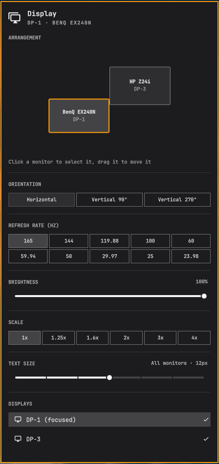
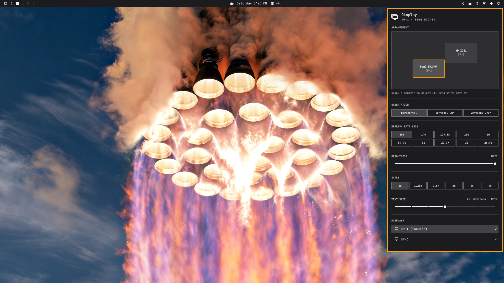

# Display panel for Omarchy

An Omarchy shell bar panel, based on the stock `omarchy.monitor`, for setting up
each monitor:

- Drag-and-drop monitor arrangement
- Orientation (horizontal or vertical, either way round)
- Refresh rate, from the modes the monitor offers, with a 15-second automatic
  revert unless confirmed
- Brightness per monitor over DDC/CI
- Scale per monitor
- Text size for the whole desktop

Settings persist as one-line rules in `~/.config/hypr/monitors.lua`.

## Screenshots



The panel open on the desktop:



## Install

```bash
git clone <this repo> ~/.config/omarchy/plugins/corico.monitor
omarchy plugin enable corico.monitor
omarchy plugin disable omarchy.monitor
omarchy restart shell
```

The panel opens from its bar icon or with `SUPER+CTRL+D`.

## Tests

```bash
node --test tests/
python3 tests/test_displayctl.py
```
